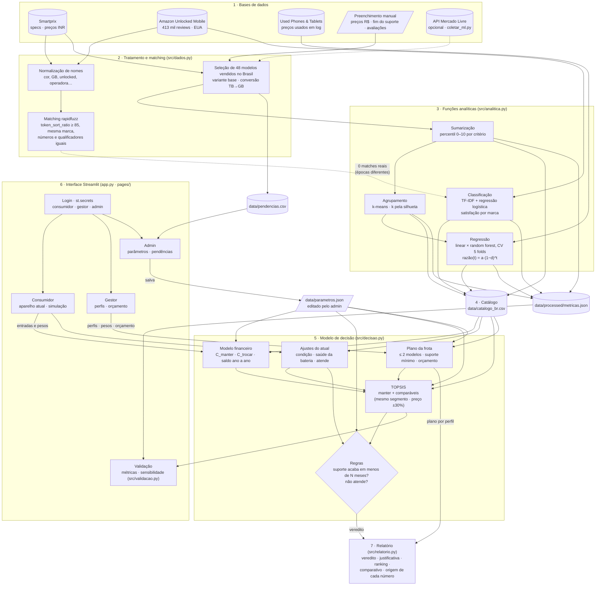
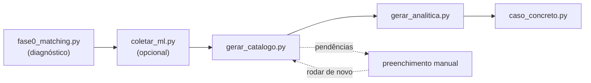
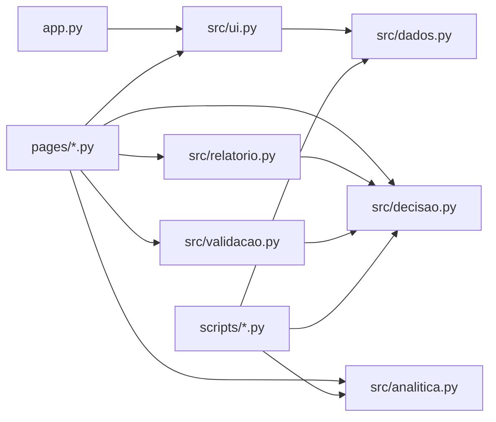

# Arquitetura e fluxo de dados do TrocaCerta

O protótipo tem duas partes separadas:

- **Pipelines offline** (`scripts/`). Rodam na máquina do desenvolvedor, leem as bases brutas e geram arquivos pequenos em `data/`.
- **App Streamlit** (`app.py` e `pages/`). Lê só esses arquivos processados. Por isso o deploy não depende das bases brutas nem da API do Mercado Livre.

## 1. Diagrama de fluxo de dados

**Como ler o diagrama:**
- Setas tracejadas são fluxos opcionais ou sem efeito. A API do ML só é usada quando há credenciais. O matching com a Amazon não encontrou modelos em comum, e por isso a satisfação é calculada por marca.
- As regras têm prioridade sobre o ranking do TOPSIS.

## 2. Pipelines offline (ordem de execução)

| Script | Lê | Grava |
|---|---|---|
| `fase0_matching.py` | Smartprix, Amazon | `processed/matching_amazon.csv`, `processed/reviews_por_modelo.csv` |
| `coletar_ml.py` | catálogo, API do ML, `.env` | `precos_ml.csv`, `avaliacoes_ml.csv`, `processed/reviews_ml.csv`, `cache/` |
| `gerar_catalogo.py` | Smartprix, `*_manuais.csv`, `*_ml.csv` | `catalogo_br.csv`, `pendencias.csv`, modelos dos arquivos manuais |
| `gerar_analitica.py` | catálogo, usados, Amazon | catálogo (notas, segmento, `a`, `d`, satisfação), `processed/metricas.json`, estatísticas |
| `caso_concreto.py` | catálogo, parâmetros | `docs/caso_concreto.md` |

## 3. Dependências entre módulos

O modelo de decisão (`decisao.py`) não depende do Streamlit. Isso permite testá-lo com pytest e reaproveitá-lo nos scripts e no documento do caso concreto.

## 4. Decisões de projeto

| Decisão | Motivo |
|---|---|
| Sem banco de dados, só CSV e JSON | Volume pequeno (48 modelos) e deploy gratuito no Streamlit Cloud |
| O app não chama APIs em tempo de execução | Reprodutibilidade, limites de requisição e funcionamento sem credenciais |
| Dados manuais separados do catálogo gerado | Regenerar o catálogo nunca apaga o que foi preenchido à mão |
| Modo demonstração com valores sinalizados | Permite rodar antes do preenchimento manual, sem esconder que os valores são simulados |
| `a` e `d` por segmento, não por modelo | As estimativas por modelo foram instáveis (dois valores de `d` saíram negativos) |
| Veredito decidido só entre as comparáveis | Evita que um topo de linha fora do orçamento vire a troca recomendada. O ranking do catálogo inteiro aparece só no relatório completo |
